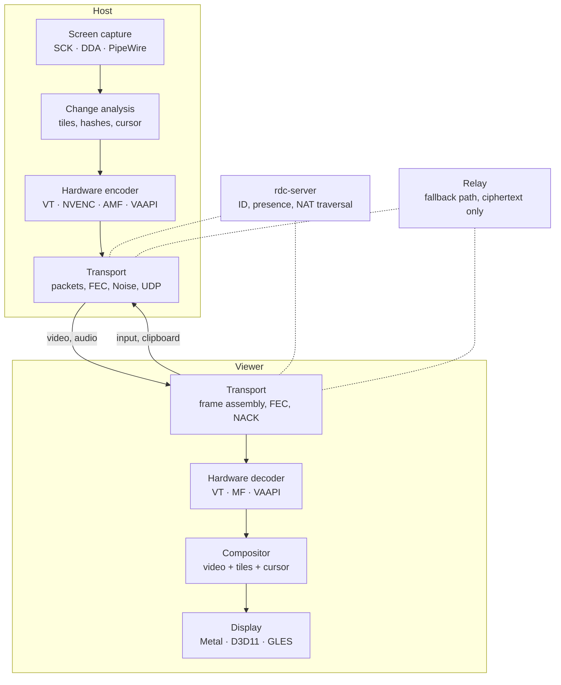

# RDC — Plan

RDC (Remote Desktop Control) is a lightweight, fast remote desktop written in Zig. A single binary both shares its own screen and connects to other computers; a small server handles IDs and relaying.

Plan version: 9 November 2026.

## Diagram



Solid arrows are the direct UDP path; dotted lines are signaling and the fallback path through the relay.

## 1. Goals in numbers

| What | Target |
|---|---|
| Size | Windows and Linux ≤ 3 MB, macOS (arm64 + x86_64) ≤ 6 MB, server ≤ 2 MB |
| Memory | host ≤ 40 MB, viewer ≤ 80 MB at 1440p |
| LAN latency | capture to display ≤ 16 ms p50, ≤ 25 ms p95 at 60 Hz |
| Static screen | 0 frames, keepalive traffic only |
| Typing code in an IDE | ≤ 100 kbps |
| Host CPU | ≤ 5% of one core at 1440p60 with a hardware encoder |
| Connection | first frame in ≤ 0.5 s |
| Startup | window in ≤ 100 ms; no installer, runtimes or DLLs next to the binary |

## 2. Platforms

| OS | Capture | Encoding and decoding | Rendering | Host input | Role |
|---|---|---|---|---|---|
| macOS 14.4+ | ScreenCaptureKit | VideoToolbox | Metal | CGEvent | host and viewer |
| Windows 10/11 | DXGI Desktop Duplication | NVENC, AMF, QSV; fallback: Media Foundation | Direct3D 11 | SendInput, SendSAS | host and viewer |
| Linux (X11, Wayland) | XShm + XDamage; portal + PipeWire | VAAPI, NVENC | OpenGL ES 3 | XTest; libei; uinput | host and viewer |
| Android | MediaProjection | MediaCodec | OpenGL ES 3 | AccessibilityService | viewer and host |
| iOS / iPadOS | ReplayKit | VideoToolbox | Metal | — | viewer and screen sharing |

Audio comes from ScreenCaptureKit, WASAPI loopback, PipeWire and AudioPlaybackCapture. CPUs: arm64 and x86_64 on every OS, including Windows on ARM. Three renderers cover everything: Metal, D3D11 and GLES 3. The last one also runs almost unchanged as WebGL 2 in the web viewer.

## 3. Core decisions

1. A frame stays in video memory all the way to the encoder: IOSurface → VideoToolbox, D3D11 texture → NVENC/AMF/QSV, DMA-BUF → VAAPI.
2. Freshness beats completeness. At most one frame is queued; stale frames are dropped. After losses the encoder references the last acknowledged frame (LTR in VideoToolbox, RFI in NVENC), and uses intra-refresh where that is unavailable. No heavy keyframes.
3. No changes, no work. Capture follows dirty rects from the OS. If the viewer window is minimized, the host pauses.
4. The viewer draws the cursor itself, and the cursor shape arrives separately (cached by hash). So the mouse responds instantly at any ping.
5. A custom UDP transport with a Noise handshake, as in WireGuard. Encryption is end-to-end: the server and relays see only ciphertext.
6. No allocations on the hot path. Pools and rings are created when a session starts; after that, not a single malloc. Zig's explicit allocators guarantee this.
7. Video codecs come from the OS and drivers and take zero bytes in the binary. We write our own code only for screen content.
8. The core is pure Zig and OS-independent. Platforms are thin backends behind a shared contract; the backend is chosen at compile time, with no virtual calls. The same core builds as the `librdc` library with a C ABI for mobile and web.
9. Reliability is built into the protocol. No action is ever lost or duplicated, and a failure of any part means a pause, not a disconnect (section 7).
10. There is no hidden mode. The host always shows a "session in progress" frame, the list of connected viewers and a Disconnect button.

## 4. Code structure

- `core/` — pure Zig; builds for any target down to wasm and is tested without an OS. It holds the protocol, crypto, transport, session state machines, the tile codec, HID layouts and UI logic.
- `platform/` — contracts (capture, encoder, decoder, renderer, window and input, audio, clipboard, key storage, service) and the `macos`, `windows`, `linux`, `android` and `ios` backends. Each backend's conformance to its contract is checked at compile time.
- `app/` — the desktop app, `server/` — the server, `mobile/` — Swift and Kotlin shells, `tools/` — the simulator and benchmarks.

```
rdc/
├─ build.zig, build.zig.zon   all targets, C dependencies
├─ src/core/        ~15k   proto · crypto · net · media · session · input · ui
├─ src/platform/    ~16k   macos · windows · linux · android · ios
├─ src/app/          ~3k   desktop, CLI, service ↔ agent process IPC
├─ src/lib.zig             core C ABI (librdc)
├─ server/           ~3k   ID, presence, NAT traversal, relay
├─ mobile/                 Swift and Kotlin shells
└─ tools/            ~4k   simulator, synthetic screen, latency measurement
```

About 40,000 lines of Zig in total.

Threads:
- On the host the chain is: capture (OS callback) → analysis → hardware encoder → packetizer → pacer. Receiving and injecting input run on their own threads.
- On the viewer: receive → frame assembly → decoder → renderer. The window and input send events back.
- Threads are connected by lock-free SPSC rings. Priority is raised with QoS on macOS, MMCSS on Windows and rtkit on Linux.
- Network and file I/O go through `std.Io` (the interface introduced in Zig 0.16). The real-time pipeline runs on its own threads.

## 5. Picture: base video + lossless refinement

- **Base layer**: hardware video without B-frames, CBR with a buffer of about one frame. The codec is the best one both sides support: AV1, then HEVC, then H.264. The host encodes at the size of the viewer's window: ScreenCaptureKit scales during capture by itself, and on Windows the D3D11 video processor does it. A 1:1 mode is also available. When the screen goes still, the host sends one extra high-quality frame.
- **Lossless refinement.** If a 64×64 tile has not changed for about 150 ms, the host sends it losslessly in the background (palette + RLE + zstd), and the viewer overlays it on the video. Text becomes pixel-perfect, and 4:2:0 color fringing disappears without 4:4:4 hardware support. Every video frame carries a map of changed tiles; those tiles come from the video again until the next refinement.
- **Hash-based tile cache**: 64 MB on each side. When scrolling or switching windows and tabs, an 8-byte reference is sent instead of the image. DXGI move rects and shift detection by row hashes turn into a "copy rectangle" command.
- **Cursor**: a separate layer. If an app hides the cursor (games, orbiting the view in Blender), the viewer switches the mouse to relative mode by itself.
- **Without a hardware encoder**, the tile codec becomes the base layer: it runs on the CPU and encodes only changed tiles.
- **Modes**: Auto, Quality and Speed. When bandwidth runs short, quality and resolution give way first, and the frame rate holds.

## 6. Transport

```
UDP datagram ≤ 1200 B (later PMTU up to ~1450)
type 1 │ session index 4 │ counter 8 │ ChaCha20-Poly1305 { channel, sequence, fragment, FEC, payload } │ tag 16
```

Overhead is 29 bytes per packet. The Noise IK handshake takes 1 RTT because the host key is known in advance. There is an anti-replay window, and keys rotate by time and volume. A session is not bound to an IP and port, so it survives network changes.

| Channel | Delivery | Priority | How it works |
|---|---|---|---|
| Control | reliable, ordered | highest | peer capabilities, permissions, pings, clock sync |
| Input | reliable, redundant | highest | input journal (section 7) |
| Video | unreliable | high | fragments, adaptive Reed–Solomon FEC, NACK only if the retransmit makes the deadline |
| Cursor | latest state | high | shape by hash, position |
| Audio | unreliable | medium | Opus in 10 ms frames, duplicates under loss, concealment, 20–60 ms buffer |
| Tile refinement | reliable, background | low | spare bandwidth only |
| Files, clipboard | reliable, background | low | on demand, resumable, BLAKE3 check |

**Congestion control:**
- Every ~25 ms the receiver reports packet arrival times.
- The sender tracks the delay trend (like GCC in WebRTC) and losses, and computes a target bitrate. The encoder adapts to it on the fly.
- A pacer (1.5× the target bitrate) smooths out bursts.
- Spare bandwidth is probed with FEC packets: they carry useful redundancy, not junk.
- On a LAN the ceiling is 100–300 Mbps.

**Paths in order of preference:**
1. LAN: broadcast discovery, works without internet.
2. Direct UDP: over IPv6 or NAT traversal (hole punching).
3. Relay over UDP.
4. Relay over TCP/443: WebSocket through an HTTPS proxy, for corporate networks.

A session starts on whichever path answers first and moves to a better one mid-session without a break.

### The browser from anywhere: WebRTC without servers of our own

The page from GitHub Pages finds the host and connects to it directly; only free public services take part.

- **Link.** `https://anods.github.io/RDC/#<code>-<key>`: the 9-digit code and a 128-bit random key (base64url, 22 characters). The host makes a new key with every code; the key never leaves the link.
- **Rendezvous.** Public MQTT brokers: broker.emqx.io and broker.hivemq.com. The host keeps plain MQTT 3.1.1 connections (TCP 1883) to both, the browser speaks MQTT over WebSocket (wss, ports 8084 and 8884). Both sides derive 48 bytes with HKDF-SHA256 (salt — the key, input — the code): the topic `rdc/<32 hex>` and an AES-256-GCM key. Every message (offer, answer, late candidates) is sealed with that key, with the topic as associated data. A broker sees a random topic and ciphertext, carries only the handshake (a few kilobytes) and never the session. Without the link a stranger cannot find the topic, and cannot forge or read the SDP.
- **Replays.** Every sealed message carries a timestamp: the host drops browser messages more than a minute off its clock (a device set to the wrong time is told so), remembers the last 256 offers and starts at most 4 sessions in 10 seconds; its replies carry the offer's timestamp back for the browser to check, and DTLS records pass an anti-replay window. The RDC window shows the link only while a broker is connected.
- **Connection.** The browser creates an `RTCPeerConnection` with public STUN (stun.l.google.com:19302, stun.cloudflare.com:3478) and one negotiated data channel (id 0, reliable, ordered) and sends the offer. The host answers from one dual-stack UDP socket with a host candidate and the public addresses it learned from the same STUN servers, then sends ICE checks to the browser's candidates, so both NATs open toward each other. The browser is the ICE controlling agent and the DTLS client.
- **Host stack, pure Zig in `src/net/`:** `stun.zig` (STUN and ICE checks), `sdp.zig`, `dtls.zig` (DTLS 1.2 server: ECDHE X25519, a self-signed ECDSA P-256 certificate made at startup, AES-128-GCM, extended master secret; the browser's certificate must match the fingerprint in the sealed offer), `sctp.zig` (one association, RFC 4960 retransmission and congestion control), `webrtc.zig` (the session), `mqtt.zig`, `signal.zig`. All cryptography is `std.crypto`.
- **Protocol.** The data channel carries the viewer protocol of `core/proto.zig` unchanged: JSON as text messages, input as binary. Browsers accept data-channel messages of 64–256 KiB at most, so host → viewer binary messages travel in pieces of up to 16 KiB, each with a one-byte prefix (1 — more follows, 0 — the last piece), and the viewer glues them back together.
- **No relay.** When both NATs are strict (a symmetric carrier NAT on the phone and a port-restricted router at home), ICE fails; the page says so in about 15 seconds instead of spinning.

## 7. Stability and input buffering

| What | Target |
|---|---|
| Lost, duplicated or reordered actions | 0; guaranteed by the protocol, checked on every commit |
| Stuck keys and mouse buttons | 0 |
| Freezes longer than 200 ms | ≤ 1 per hour on a typical home network |
| Network change (Wi-Fi → LTE) | the session continues within ≤ 1 s, no re-login |
| Agent process crash, GPU driver reset, monitor change | pause ≤ 2 s, the session does not drop |
| 72 hours non-stop | memory and handle count do not grow, latency does not increase |

**Input journal:**
- **Every action is numbered and timestamped.** A key press, click, scroll or text input gets a sequence number and a time. Each packet carries all actions not yet acknowledged, so losing one packet delays nothing. The host applies every action exactly once, strictly in order.
- **Original timing.** The host replays actions with the same intervals the user had (a small adaptive input buffer, a few milliseconds). Network jitter will not turn a double click into two single clicks, break a drag or scramble fast typing.
- **Held-key reconciliation.** With each keepalive the viewer reports which keys and buttons are currently held. The host fixes any mismatch itself and releases everything on disconnect.
- **Short outage (up to ~2 s).** Actions accumulate in the journal and go out unchanged once the connection is back.
- **Long outage.** Nothing is replayed blindly: the screen may have changed in the meantime. The viewer shows "Not sent: 12 actions" with Send and Discard buttons.
- **Mouse movements** do not accumulate: only the latest position matters.

**Session:**
- **Ticket-based reconnect.** Both sides keep session state for 60 s. The viewer comes back over any path with a one-time ticket bound to the session keys, with no password or dialog. The host sends a fresh frame and resumes input from the last sequence number. While the connection is down, the screen shows the last frame with a "Reconnecting…" banner, not a black window.
- **Hot standby path.** While P2P works, the relay path is kept ready. If no acknowledgments arrive for 2–3 RTTs, the session switches to the relay within ≤ 0.5 s.
- **Smoothness or latency.** The viewer measures jitter and, when it is high, buffers up to one frame so motion stays smooth. A "Smoothness ↔ Latency" slider defaults to Auto.

**Self-healing host:**
- **Service and agent process.** When installed, the network session lives in a service: a daemon on macOS (as Apple recommends), a service on Windows, systemd on Linux. Capture, encoding and input run in the agent process, and the two communicate through shared memory. If the agent process crashes, the service starts a new one, and the viewer sees a one-second pause, not a disconnect.
- **Watchdogs.** Every pipeline stage sends a heartbeat. If a stage gets stuck, only that stage is restarted.
- **Fallbacks.** If an encoder fails mid-session, the next one takes over: NVENC → Media Foundation → tile codec. On device loss (UAC, lock screen, GPU driver reset, resolution change, new monitor) the pipeline is rebuilt within ≤ 300 ms.
- **Bounded queues.** Each channel has its own overflow policy: video drops old data, input never drops anything, file transfer pauses.
- **Monotonic time only.** System clock jumps break nothing; the session sleeps and wakes with the machine.

**How we test:**
- **Deterministic simulator**, as in TigerBeetle, the financial database in Zig that tests itself this way. Host, viewer and server run in one process with virtual time and a virtual network.
  - Every run covers thousands of seeds with random losses, duplicates, reordering, path failures, clock jumps and agent process crashes.
  - Invariants: no action is lost, duplicated or reordered; no keys stay held after a session; frames never go backwards; memory does not grow.
  - A failing seed reproduces exactly.
- **`zig build sim`** runs the same simulator with a synthetic screen (typing, scrolling, video, window dragging) and outputs p50/p95/p99 latency, bitrate and freezes. CI catches regressions by these numbers.
- **Fuzzing** of all parsers with Zig's built-in fuzzer. Property tests for wrapping sequence-number arithmetic.
- **Before every release**, a 72-hour run with random input, plus network impairment tests on real machines: dummynet on macOS, netem on Linux, clumsy on Windows.
- **Flight recorder.** On every freeze or error, the last 30 s of statistics are written to disk: frames, latencies, paths, with no screen content or keystrokes. On a crash, a minidump and stack trace are saved. They are sent to the developer only with the user's consent.
- **Coding rules in the spirit of Tiger Style:** memory is allocated at startup, loops and queues are bounded, invariants are checked with assert, no recursion. Everything that parses network data is built in ReleaseSafe, so bounds and overflow checks stay in release builds.
- **Version compatibility.** A new version works with the previous one (N−1), and CI checks this. An update installs only when no session is active, atomically, with automatic rollback if the new version fails to start twice.

## 8. Server: `rdc-server`

- **One binary.** A static Linux (musl) binary of about 2 MB with a ZON config; it runs on any VPS. You can run your own server anywhere; devices register on it only with the organization key.
- **Presence.** Devices keep a UDP binding to the server and send a keepalive every 25 s. 10,000 devices produce about 400 packets per second.
- **Rendezvous.**
  1. The viewer looks up the ID on the server.
  2. The server sends both sides the candidates (local, public and IPv6 addresses) and a common start time.
  3. Both sides knock on each other at the same moment; port prediction is used for symmetric NAT.
  4. If hole punching has not succeeded within ~1 s, the session is already running through the relay by then.
- **The relay** forwards encrypted datagrams by session token (HMAC, expiry, bandwidth limit) and cannot decrypt them. Datagrams are processed in batches via recvmmsg/sendmmsg, and the load is spread across cores with SO_REUSEPORT.
- **ID ↔ key registry**: an append-only log with snapshots, no DBMS. Limits per IP and ID, cookie replies under load (as in WireGuard), Prometheus metrics.

## 9. Security

- **Device keys**: X25519 for Noise and Ed25519 for signatures. They are generated on first launch and stored in Keychain, DPAPI, Secret Service or Android Keystore.
- **ID**: 9 digits, 8 random plus a Damm check digit. It catches any single-digit error and any swap of adjacent digits. The server issues the ID and binds it to the device key; an alias can be set.
- **Key pinning.** The host key is remembered on first connection. If it changes, the viewer warns loudly. The dialog shows the key fingerprint so it can be verified by voice.
- **Three access modes:**
  - on request: the person at the host clicks Accept and picks the permissions (control, clipboard, files, audio, reboot);
  - unattended: by password; the host stores only an Argon2id hash, TOTP can be added, and the delay before another attempt grows after failures;
  - trusted devices: key-based login without a password, like `authorized_keys` in SSH. Handy for your own computers.
- **Protection against phone scammers.** When a stranger connects, a cautious profile without file transfer is on by default, and the person at the host is asked directly: "Do you know this person?" Only trusted devices can black out the host screen. All sessions are logged.
- **The "session in progress" frame** is excluded from capture (`SCContentFilter` on macOS, `WDA_EXCLUDEFROMCAPTURE` on Windows).
- **All cryptography** comes from `std.crypto`: X25519, ChaCha20-Poly1305, BLAKE2s and BLAKE3, Ed25519, Argon2id, HMAC. No OpenSSL or libsodium needed.

## 10. Input

- **Keys** are sent as physical USB HID codes, identical on every OS, and the host applies the layout.
- **Text mode (Unicode)** for when the layouts differ: type in Russian on a Mac, and Russian text arrives on the PC.
- **Modifier profiles:** when controlling Windows from a Mac, Cmd works as Ctrl, and vice versa.
- **System shortcuts.** Cmd+Tab, Alt+Tab and Win are intercepted while the session window has focus. Ctrl+Alt+Del has a button.
- **Mouse and tablet.** The mouse works in absolute and relative modes; trackpad scrolling is smooth, in pixels. A tablet sends pressure (for sculpting in Blender); touches come from phones and iPads.

## 11. Interface

- **Custom UI.** A lightweight immediate-mode UI is drawn by the same renderer as the video. The OS rasterizes text (CoreText, DirectWrite, system FreeType), so the binary carries no fonts. All icons are in one SDF texture.
- **Screens:**
  - main: my ID, a Connect field, recent connections with thumbnails, address book;
  - incoming request;
  - a slim session bar: monitor, quality, view only, Ctrl+Alt+Del, files, chat, recording, full screen, disconnect;
  - settings and an icon in the tray and menu bar.
- **Stats overlay:** fps, bitrate, RTT, loss, current path (LAN, P2P or relay), codec and the latency of each stage.
- **Language and theme.** The UI is English only; the theme follows the system. On mobile: native SwiftUI and Kotlin shells on top of `librdc`.

## 12. Platform specifics

**macOS**
- Requires the Screen Recording and Accessibility (for input) permissions. Newer macOS versions also have a separate Remote Desktop category. A helper screen checks the permissions and opens the right section of System Settings.
- The login screen is supported the way Apple recommends:
  - a daemon holds the network;
  - an agent process with `LimitLoadToSessionType = [Aqua, LoginWindow]` handles capture and input;
  - both are registered via SMAppService.
- ScreenCaptureKit works in the LoginWindow session since macOS 14.4, hence the minimum version.
- Development needs a persistent self-signed certificate, otherwise TCC permissions reset on every rebuild. Distribution needs a Developer ID, notarization and the Persistent Content Capture entitlement (granted on request for VNC-like apps).
- No Xcode needed: the Command Line Tools SDK is enough, and Metal shaders are compiled at launch.

**Windows**
- `rdc.exe` runs in three roles:
  - normal launch: the UI;
  - `--service`: a LocalSystem service that holds the network session and registration, starts the agent process in the active session and sends Ctrl+Alt+Del via SendSAS;
  - `--agent`: the agent process with a SYSTEM token in the user's session; it handles capture, encoding, input, audio and switching to the secure desktop (UAC, lock screen).
- Without installation the app runs in portable mode; installing adds the service.
- Driver DLLs for NVENC, AMF and QSV are loaded at runtime, so there are no build-time dependencies.
- Decoding goes through Media Foundation in low-latency mode, on D3D11 textures. Shaders are compiled by the system `d3dcompiler_47.dll`.
- The binary is Authenticode-signed.

**Linux**
- X11: XShm, XDamage, XFixes and XTest.
- Wayland: the ScreenCast + RemoteDesktop portal, input via libei (`ConnectToEIS`). The restore token is saved so permission is not requested every time.
- The unattended service injects events through uinput.
- All system libraries (X11, Wayland, PipeWire, VAAPI, EGL, FreeType) are loaded with dlopen. The build target is `x86_64-linux-gnu.2.28`: the binary is built on a Mac and runs on distributions from about 2018 onward.

**Android**
- Capture: MediaProjection; consent is required for every session (an Android 14+ rule).
- Input via AccessibilityService, audio via AudioPlaybackCapture.
- The core is built by Zig with the NDK.

**iOS / iPadOS**
- The device works as a viewer. It can only share its own screen, via ReplayKit; the core fits within the extension memory limit (~50 MB).
- Building requires full Xcode.

## 13. Build

- **Zig version.** Zig 0.17.1 (released 2 November 2026), pinned in `build.zig.zon`.
- **All desktop builds from one Mac with one command:** macOS (universal), Windows x64 and arm64 (via mingw, without MSVC or the VC++ Redistributable), Linux x64 and arm64, and the server. iOS is built with Xcode, Android with the NDK.
- **Optimization modes by part:**
  - hot media loops: ReleaseFast; on x86 in two variants, x86-64-v2 and AVX2, selected by CPUID;
  - network and session: ReleaseSafe;
  - everything else: ReleaseSmall.
- **SIMD via `@Vector`:** tile hashes, comparison, palettes, color conversion.
- **Dependencies.** The only C dependencies are opus and zstd, which Zig builds from source itself. NVENC, AMF and VPL headers live in the repository. No Qt, Flutter, Electron, protobuf or OpenSSL.
- **OS headers** are imported through translate-c in `build.zig`. Objective-C code is thin `.m` shims compiled by the same Zig.
- **Self-test.** `rdc --selftest` on any machine shows what capture, the encoders and the decoders can do, and the latency of each stage. Debug builds include the Tracy profiler. CI builds and tests on three OSes.
- **Test machines.** Linux in a virtual machine (UTM, arm64), Windows on a separate PC, optionally over SSH.

## 14. Stages

Steps are small and verifiable. Each one ends with a short report and a choice of the next one.

0. **Foundation**
   - Repository, Zig 0.17.1, `build.zig` with all targets, CI.
   - Platform contracts with stub backends for the three desktop OSes.
   - Core: time, pools, rings, logging, config, messages with comptime serialization, Noise IK.
   - Deterministic simulator with fault injection.

   Done when `zig build test` is green and an `.exe` built on the Mac runs on Windows and prints the key fingerprint.

1. **Picture on three OSes**
   - macOS: ScreenCaptureKit → VideoToolbox → UDP → VideoToolbox → Metal, stats overlay, loopback test on one Mac.
   - Windows: DXGI → NVENC or Media Foundation → D3D11.
   - Linux: X11 → VAAPI or tile codec → GLES.

   Done when any pair of OSes shows each other's screens by IP on a LAN at 1440p60 with ≤ 16 ms p50 latency by the built-in measurement, and not a single packet is sent while idle.

2. **Control**
   - HID-code input on all OSes: input journal, replay with original timing, held-key reconciliation.
   - Text mode, modifier profiles, system shortcuts, relative mouse.
   - Cursor as a separate layer, clipboard, LAN discovery.

   Done when:
   - working in Blender and Godot on a Windows PC from a Mac is comfortable, and vice versa;
   - with 30 ms RTT and 1% loss in the simulator, it feels the same;
   - across 10,000 seeds, not a single action is lost or duplicated.

3. **Internet**
   - `rdc-server` on a VPS.
   - NAT traversal, relay over UDP and TCP/443, upgrade from the relay to the direct path, hot standby path, ticket-based reconnect.
   - Congestion control, pacer, adaptive FEC, recovery via LTR/RFI.
   - Incoming request dialog with permissions, key pinning.

   Done when:
   - a Mac on mobile internet controls a home PC, and connecting takes ≤ 1 s;
   - after switching from Wi-Fi to a phone hotspot, the session continues within ≤ 1 s;
   - in the simulator (5 Mbps, 80 ms, 2% loss) there are no freezes longer than 200 ms.

4. **Product**
   - The whole UI: main screen, address book, session bar, settings, tray.
   - Unattended access, trusted devices, session log, session frame.
   - Service and agent process on all three OSes (UAC, lock screen, login screen, Wayland portal), watchdogs, codec fallbacks, flight recorder.
   - Signing, notarization, packages, self-update with an Ed25519 signature and automatic rollback.

   Done when:
   - a non-technical person installs the app, reads out the ID and accepts the connection;
   - unattended access survives a reboot and the lock screen;
   - memory does not grow over 72 hours;
   - a killed agent process or a GPU driver reset causes a pause of ≤ 2 s without a disconnect.

5. **Sharpness and features**
   - Lossless refinement, tile cache, move rects; AMF and QSV encoders.
   - Audio (Opus), files (drag-and-drop, resume), multiple monitors, chat.
   - Session recording: the already compressed stream is written to disk, so it is almost free.

   Done when:
   - text in an IDE becomes pixel-perfect after ≤ 150 ms of idle;
   - scrolling a long document takes ≤ 30% of the bitrate it takes without the cache;
   - a 1 GB file transfers over a LAN at network speed.

6. **Mobile and web**
   - Android: viewer and host.
   - iOS/iPadOS: viewer and screen sharing.
   - Web viewer: core in wasm, WebCodecs, WebSocket through the relay.

   Done when a phone can control a PC, and an Android phone can share its screen and be controlled.

7. **Later**
   - Virtual monitor for PCs without a display.
   - Unattended Wayland (via GNOME and KDE APIs).
   - TCP port tunnels, Wake-on-LAN.
   - End-to-end encrypted address book, multiple servers.

## 15. Decisions

- Name: RDC (Remote Desktop Control).
- The repository is public, on GitHub.
- License: Apache-2.0.
- No servers of our own: direct connections and free public infrastructure; our own protocol.
- WebRTC in the host is our own small stack in Zig (ICE, DTLS 1.2, SCTP on `std.crypto`), not libdatachannel (about 2 MB of C++ plus a TLS library) and not WebTransport (it cannot cross NAT); the browser finds the host through public MQTT brokers.
- Main focus: RDC as a tool for AI agents that see and control other devices.
- Agent mode as a plugin for Claude and for ChatGPT/Codex: the `rdc mcp` MCP server and a skill.
- The Claude plugin ships the binary as an MCP bundle (`rdc-mcp.mcpb`, a release asset); the Codex plugin launches an installed RDC through `plugins/rdc/scripts/rdc-mcp`.
- Screenshots for agents are JPEG, at most 1280×800, so the model sees them at 1:1 and reads exact coordinates.
- Development starts on macOS; platform contracts are designed for all OSes from the start.
- Connection by link, by code and through Steam (tested on Spacewar, AppID 480); access from a browser.
- Updates install themselves from GitHub Releases, with an Ed25519-signed manifest; GitHub Actions builds releases for all OSes.
- Everything in the repository is in English: code and comments, docs, UI, commit messages, release notes.

## 16. Milestones

A milestone is something you can run and see. The stages in section 14 remain the full scope of work; milestones set the order in which results are shown.

| Milestone | What you see | Done when |
|---|---|---|
| M1 "First demo" | RDC.app on a Mac shows a code and a link; with them, a browser shows the Mac's screen live, with mouse and keyboard | the link opens on this Mac, on a PC and on a phone on the same network; H.264 via WebCodecs where the browser supports it, JPEG otherwise |
| M2 "Native client" | a native RDC viewer on macOS | connection by code on a LAN, UDP + Noise transport, latency ≤ 16 ms p50 |
| M3 "Windows" | RDC on a PC: host and viewer | a Mac controls a PC, and vice versa |
| M4 "Steam" | connecting through Steam: friends, invites, Valve relays (SDR) | two computers with RDC connect by SteamID through Steam Networking Sockets on Spacewar (AppID 480); then our own AppID and a Steam page |
| M5 "Anywhere" | connection by code and link from any network, without servers of our own | NAT traversal, peer discovery and the fallback path go through free public infrastructure; the browser connects via WebRTC |

M4 needs the Steamworks SDK: it is downloaded from partner.steamgames.com into `third_party/steamworks/` and is not committed to the repository.

## 17. Scenarios

1. **At home, on the same network.** Works today. You open the link from the RDC window. The computer serves the page itself; GitHub Pages is not needed.
2. **Away from home, from a phone.** Works in builds after 0.3.0. RDC is running on the computer; its window shows a second link, "From anywhere": https://anods.github.io/RDC/#123456789-key. The page comes from GitHub Pages and finds the computer through public MQTT brokers (broker.emqx.io, broker.hivemq.com): both sides derive the topic and an encryption key from the code and the key in the link, so a broker carries only sealed SDP and cannot tell who talks to whom. Then the browser connects to the computer directly over a WebRTC data channel (public STUN, ICE hole punching, DTLS, SCTP — section 6). If the networks on both sides block a direct path, the page says so after about 15 seconds: there is no relay. Nothing needs to be installed on the phone; the link changes with every new code, and `rdc --no-remote` turns this off.
3. **An AI agent on your computer (Claude Code, Codex, Claude Desktop).** Works since 0.3.0. You install the RDC plugin (`plugins/rdc`: a Claude Code plugin, a portable Agent Plugin for Codex, and the `rdc-mcp.mcpb` bundle for Claude Desktop), and through `rdc mcp` the agent connects by link or code to any device running RDC. The agent gets `connect`, `screenshot`, `click`, `move`, `drag`, `scroll`, `type`, `key`, `wait`, `devices`, `disconnect`; every action answers with a fresh screenshot. GitHub Pages is not involved.
4. **An AI agent in the cloud (claude.ai, ChatGPT in a browser).** Works since 0.3.0. `rdc mcp --http --tunnel` serves Streamable HTTP on this computer, opens a Cloudflare quick tunnel and logs a URL with a secret path; that URL is added as a connector. Without `cloudflared`, any tunnel to `127.0.0.1:7710` does.
5. **Supervising an agent.** Works since 0.3.0. The RDC window shows "AI agent <name>" and its Disconnect button becomes **Stop AI agent**; a browser viewer on the same link shows a red banner with a Stop button. Stop disconnects the AI agents and keeps the people connected.

GitHub Pages publishes the `web/` folder at https://anods.github.io/RDC/ (`.github/workflows/pages.yml`; enabled once in Settings → Pages → Source: GitHub Actions). There the viewer connects only by a link from anywhere; the code alone works on the computer's own network, where the computer serves the page itself. For testing, `rdc --remote-url http://localhost:8000/` makes the window link to any local copy of `web/` (localhost counts as a secure context, so WebCrypto and WebRTC work).

The MCP server (`src/agent/mcp.zig`) speaks both protocol eras: the `initialize` handshake of 2025-11-25 and earlier, and the per-request `_meta` of 2026-07-28 with `server/discover`. Over HTTP it validates the `MCP-Protocol-Version`, `Mcp-Method` and `Mcp-Name` headers and checks the `Origin` header when there is no token.

## Links

- [Zig: release list](https://ziglang.org/download/index.json)
- [Zig 0.16 released: I/O as an interface](https://tproger.ru/news/vywel-zig-0-16-di-v-main-i-o-kak-interfejs-i-async-bez-raskra)
- [Zig 0.17: reworked build system](https://linuxiac.com/zig-0-17-programming-language-lands-with-reworked-build-system/)
- [Apple DTS: capturing the login screen with an agent in LoginWindow](https://developer.apple.com/forums/thread/814152)
- [Persistent Content Capture entitlement](https://developer.apple.com/forums/thread/761641)
- [The "Remote Desktop" permission in newer macOS](https://developer.apple.com/forums/thread/841530)
- [xdg-desktop-portal: RemoteDesktop](https://flatpak.github.io/xdg-desktop-portal/docs/doc-org.freedesktop.portal.RemoteDesktop.html)
- [Steamworks: ISteamNetworkingSockets](https://partner.steamgames.com/doc/api/ISteamNetworkingSockets)
