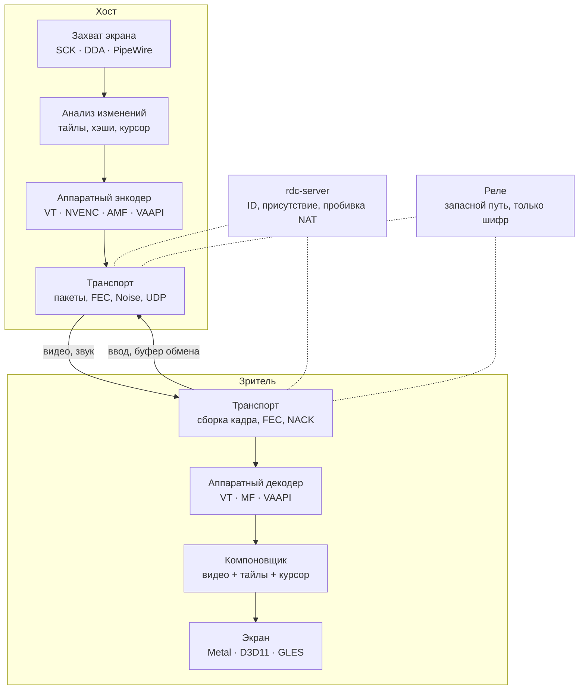

# RDC — план

RDC (Remote Desktop Control) — лёгкий и быстрый удалённый рабочий стол на Zig. Один бинарник умеет и показывать свой экран, и подключаться к чужому; к нему — небольшой сервер для ID и реле.

Версия плана — 9 ноября 2026.

## Схема



Сплошные стрелки — прямой путь по UDP, пунктир — сигналинг и запасной путь через реле.

## 1. Цели в цифрах

| Что | Цель |
|---|---|
| Размер | Windows и Linux ≤ 3 МБ, macOS (arm64 + x86_64) ≤ 6 МБ, сервер ≤ 2 МБ |
| Память | хост ≤ 40 МБ, зритель ≤ 80 МБ при 1440p |
| Задержка в LAN | от захвата до показа ≤ 16 мс p50, ≤ 25 мс p95 при 60 Гц |
| Неподвижный экран | 0 кадров, трафик только keepalive |
| Набор кода в IDE | ≤ 100 кбит/с |
| CPU хоста | ≤ 5 % одного ядра на 1440p60 с аппаратным энкодером |
| Подключение | первый кадр ≤ 0,5 с |
| Запуск | окно ≤ 100 мс; без установщика, рантаймов и DLL рядом |

## 2. Платформы

| ОС | Захват | Кодирование и декодирование | Рендер | Ввод на хосте | Роль |
|---|---|---|---|---|---|
| macOS 14.4+ | ScreenCaptureKit | VideoToolbox | Metal | CGEvent | хост и зритель |
| Windows 10/11 | DXGI Desktop Duplication | NVENC, AMF, QSV; запасной — Media Foundation | Direct3D 11 | SendInput, SendSAS | хост и зритель |
| Linux (X11, Wayland) | XShm + XDamage; портал + PipeWire | VAAPI, NVENC | OpenGL ES 3 | XTest; libei; uinput | хост и зритель |
| Android | MediaProjection | MediaCodec | OpenGL ES 3 | AccessibilityService | зритель и хост |
| iOS / iPadOS | ReplayKit | VideoToolbox | Metal | — | зритель и показ своего экрана |

Звук берём из ScreenCaptureKit, WASAPI loopback, PipeWire и AudioPlaybackCapture. Процессоры — arm64 и x86_64 на всех ОС, включая Windows on ARM. Трёх рендеров хватает на всё: Metal, D3D11 и GLES 3. Последний почти без изменений работает и как WebGL 2 в веб-зрителе.

## 3. Решения, на которых всё держится

1. Кадр не покидает видеопамять до энкодера: IOSurface → VideoToolbox, текстура D3D11 → NVENC/AMF/QSV, DMA-BUF → VAAPI.
2. Свежесть важнее полноты. В очереди не больше одного кадра, устаревшие выбрасываются. После потерь энкодер ссылается на последний подтверждённый кадр (LTR в VideoToolbox, RFI в NVENC), а где этого нет — использует intra-refresh. Тяжёлых ключевых кадров нет.
3. Нет изменений — нет работы. Захват идёт по dirty rects от ОС. Если окно зрителя свёрнуто, хост встаёт на паузу.
4. Курсор зритель рисует сам, а форма приходит отдельно (кэш по хэшу). Поэтому мышь отзывается мгновенно при любом пинге.
5. Свой транспорт на UDP с рукопожатием Noise, как в WireGuard. Шифрование сквозное: сервер и реле видят только шифротекст.
6. В горячем пути нет аллокаций. Пулы и кольца создаются при старте сессии, дальше нет ни одного malloc. Явные аллокаторы Zig это гарантируют.
7. Видеокодеки берём у ОС и драйверов, в бинарнике они не занимают ни байта. Свой код — только для экранного контента.
8. Ядро написано на чистом Zig и не зависит от ОС. Платформы — тонкие бэкенды за общим контрактом; бэкенд выбирается при компиляции, без виртуальных вызовов. То же ядро собирается библиотекой `librdc` с C ABI для мобильных и веба.
9. Надёжность заложена в протокол. Ни одно действие не теряется и не задваивается, а сбой любой части даёт паузу, а не обрыв (раздел 7).
10. Скрытого режима нет. На хосте всегда видна рамка «идёт сессия», список подключённых и кнопка «отключить».

## 4. Устройство кода

- `core/` — чистый Zig, собирается под любую цель вплоть до wasm и тестируется без ОС. Здесь протокол, крипто, транспорт, машины состояний сессий, тайловый кодек, раскладки HID и логика UI.
- `platform/` — контракты (захват, энкодер, декодер, рендер, окно и ввод, звук, буфер обмена, ключи, служба) и бэкенды `macos`, `windows`, `linux`, `android`, `ios`. Соответствие бэкенда контракту проверяется при компиляции.
- `app/` — десктопное приложение, `server/` — сервер, `mobile/` — оболочки на Swift и Kotlin, `tools/` — симулятор и замеры.

```
rdc/
├─ build.zig, build.zig.zon   все цели, C-зависимости
├─ src/core/        ~15k   proto · crypto · net · media · session · input · ui
├─ src/platform/    ~16k   macos · windows · linux · android · ios
├─ src/app/          ~3k   десктоп, CLI, IPC служба ↔ агент
├─ src/lib.zig             C ABI ядра (librdc)
├─ server/           ~3k   ID, присутствие, пробивка NAT, реле
├─ mobile/                 оболочки Swift и Kotlin
└─ tools/            ~4k   симулятор, синтетический экран, замер задержки
```

Всего около 40 тысяч строк на Zig.

Потоки:
- На хосте цепочка такая: захват (колбэк ОС) → анализ → аппаратный энкодер → пакетизатор → пейсер. Приём и инжекция ввода идут в своих потоках.
- У зрителя: приём → сборка кадра → декодер → рендер. Окно и ввод отправляют события обратно.
- Между потоками — кольца SPSC без блокировок. Приоритет повышаем через QoS на macOS, MMCSS на Windows и rtkit на Linux.
- Сетевой и файловый ввод-вывод идёт через `std.Io` (интерфейс появился в Zig 0.16). Конвейер реального времени работает на своих потоках.

## 5. Картинка: базовое видео + доводка без потерь

- **Базовый слой** — аппаратное видео без B-кадров, CBR с буфером около одного кадра. Кодек выбирается лучший из поддержанных обеими сторонами: AV1, затем HEVC, затем H.264. Хост кодирует в размере окна зрителя: ScreenCaptureKit масштабирует при захвате сам, на Windows это делает видеопроцессор D3D11. Есть и режим 1:1. Когда экран замер, хост отправляет один дополнительный кадр высокого качества.
- **Доводка без потерь.** Если тайл 64×64 не менялся около 150 мс, хост в фоне отправляет его без потерь (палитра + RLE + zstd), и зритель накладывает его поверх видео. Текст становится пиксель-в-пиксель, цветная кайма от 4:2:0 пропадает — без поддержки 4:4:4 в железе. Каждый видеокадр несёт карту изменённых тайлов; они снова идут из видео до следующей доводки.
- **Кэш тайлов по хэшу** — 64 МБ на каждой стороне. При прокрутке и переключении окон и вкладок вместо картинки уходит ссылка в 8 байт. Move rects от DXGI и поиск сдвига по хэшам строк превращаются в команду «скопируй прямоугольник».
- **Курсор** — отдельный слой. Если приложение прячет курсор (игры, вращение вида в Blender), зритель сам переключает мышь в относительный режим.
- **Без аппаратного энкодера** базой становится тайловый кодек: он работает на CPU и кодирует только изменённые тайлы.
- **Режимы** «Авто», «Качество» и «Скорость». Когда полосы не хватает, первыми уступают качество и разрешение, а частота кадров держится.

## 6. Транспорт

```
UDP-датаграмма ≤ 1200 Б (позже PMTU до ~1450)
тип 1 │ индекс сессии 4 │ счётчик 8 │ ChaCha20-Poly1305 { канал, номер, фрагмент, FEC, данные } │ тег 16
```

Накладные расходы — 29 байт на пакет. Рукопожатие Noise IK занимает 1 RTT, потому что ключ хоста известен заранее. Есть окно защиты от повторов, ключи меняются по времени и объёму. Сессия не привязана к IP и порту, поэтому переживает смену сети.

| Канал | Доставка | Приоритет | Как устроен |
|---|---|---|---|
| Управление | надёжно, по порядку | высший | возможности сторон, права, пинги, сверка часов |
| Ввод | надёжно, с избыточностью | высший | журнал действий (раздел 7) |
| Видео | ненадёжно | высокий | фрагменты, адаптивный FEC Рида — Соломона, NACK — только если повтор успевает к сроку |
| Курсор | последнее состояние | высокий | форма по хэшу, позиция |
| Звук | ненадёжно | средний | Opus по 10 мс, дубли при потерях, маскировка, буфер 20–60 мс |
| Доводка тайлов | надёжно, в фоне | низкий | только остаток полосы |
| Файлы, буфер обмена | надёжно, в фоне | низкий | по запросу, докачка, проверка BLAKE3 |

**Контроль перегрузки:**
- Получатель каждые ~25 мс сообщает время прихода пакетов.
- Отправитель следит за трендом задержки (как GCC в WebRTC) и за потерями и вычисляет целевой битрейт. Энкодер подстраивается под него на лету.
- Пейсер (1,5× от целевого битрейта) сглаживает всплески.
- Свободную полосу прощупываем пакетами FEC: они несут полезную избыточность, а не мусор.
- В LAN потолок — 100–300 Мбит/с.

**Пути в порядке предпочтения:**
1. LAN — обнаружение широковещанием, работает без интернета.
2. Прямой UDP — через IPv6 или пробивку NAT.
3. Реле по UDP.
4. Реле по TCP/443 — WebSocket через HTTPS-прокси, для корпоративных сетей.

Сессия стартует по пути, который ответил первым, и посреди сессии переходит на лучший без разрыва.

## 7. Стабильность и буферизация действий

| Что | Цель |
|---|---|
| Потерянные, задвоенные или переставленные действия | 0; это гарантирует протокол, проверка на каждом коммите |
| Залипшие клавиши и кнопки мыши | 0 |
| Замирания дольше 200 мс | ≤ 1 в час на обычной домашней сети |
| Смена сети (Wi-Fi → LTE) | сессия продолжается через ≤ 1 с, без повторного входа |
| Падение агента, сброс драйвера GPU, смена монитора | пауза ≤ 2 с, сессия не рвётся |
| 72 часа без перерыва | память и число дескрипторов не растут, задержка не увеличивается |

**Журнал действий:**
- **Номер и время у каждого действия.** Клавиша, клик, прокрутка или текст получают номер и время. Пакет несёт все ещё не подтверждённые действия, поэтому потеря одного пакета ничего не задерживает. Хост применяет каждое действие ровно один раз и строго по порядку.
- **Исходные интервалы.** Хост воспроизводит действия с теми же промежутками, что были у пользователя (небольшой адаптивный буфер ввода, единицы миллисекунд). Джиттер сети не превратит двойной клик в два одиночных, не оборвёт перетаскивание и не перемешает быструю печать.
- **Сверка зажатых клавиш.** Вместе с keepalive зритель сообщает, какие клавиши и кнопки сейчас зажаты. Расхождение хост исправляет сам, а при обрыве отпускает всё.
- **Короткий обрыв (до ~2 с).** Действия копятся в журнале и после восстановления уходят как были.
- **Долгий обрыв.** Вслепую ничего не воспроизводится — экран за это время мог измениться. Зритель показывает «не отправлено: 12 действий» с кнопками «Отправить» и «Отменить».
- **Движения мыши** не копятся: важна только последняя позиция.

**Сессия:**
- **Переподключение по билету.** Обе стороны хранят состояние сессии 60 с. Зритель возвращается любым путём с одноразовым билетом, привязанным к ключам сессии, — без пароля и диалога. Хост досылает свежий кадр и продолжает ввод с последнего номера. Пока связи нет, на экране последний кадр с плашкой «Переподключение…», а не чёрное окно.
- **Горячий запасной путь.** Пока работает P2P, путь через реле держится наготове. Если подтверждений нет 2–3 RTT, сессия переключается на реле за ≤ 0,5 с.
- **Плавность или задержка.** Зритель меряет джиттер и, когда он большой, держит в буфере до одного кадра, чтобы движение шло ровно. Есть ползунок «Плавность ↔ Задержка», по умолчанию — «Авто».

**Хост сам себя чинит:**
- **Служба и агент.** В установленном режиме сетевая сессия живёт в службе: на macOS это демон (так советует Apple), на Windows — служба, на Linux — systemd. Захват, кодирование и ввод работают в агенте, связь между ними — через общую память. Если агент упал, служба поднимает новый, и зритель видит секундную паузу, а не обрыв.
- **Сторожа.** Каждая стадия конвейера шлёт пульс. Если стадия застряла, перезапускается только она.
- **Откат на запасные средства.** При ошибке энкодера посреди сессии включается следующий: NVENC → Media Foundation → тайловый кодек. При потере устройства (UAC, блокировка, сброс драйвера GPU, смена разрешения, новый монитор) конвейер пересоздаётся за ≤ 300 мс.
- **Ограниченные очереди.** У каждого канала своя политика переполнения: видео выбрасывает старое, ввод не выбрасывает никогда, передача файлов встаёт на паузу.
- **Только монотонное время.** Скачки системных часов ничего не ломают, сессия засыпает и просыпается вместе с машиной.

**Как проверяем:**
- **Детерминированный симулятор**, как в TigerBeetle — финансовой базе данных на Zig, которая так проверяет себя. Хост, зритель и сервер работают в одном процессе с виртуальным временем и виртуальной сетью.
  - На каждом прогоне — тысячи сидов со случайными потерями, задвоениями, перестановками, обрывами путей, скачками часов и падениями агента.
  - Инварианты: ни одно действие не потеряно, не задвоено и не переставлено; после сессии нет зажатых клавиш; кадры не идут назад; память не растёт.
  - Упавший сид воспроизводится точь-в-точь.
- **`zig build sim`** — тот же симулятор с синтетическим экраном: печать, прокрутка, видео, перетаскивание окон. На выходе p50/p95/p99 задержки, битрейт и замирания. По этим числам CI ловит регрессии.
- **Фаззинг** всех парсеров встроенным фаззером Zig. Property-тесты для арифметики номеров с переполнением.
- **Перед каждым релизом** — прогон 72 часа со случайным вводом и проверка помехами на живых машинах: dummynet на macOS, netem на Linux, clumsy на Windows.
- **Бортовой самописец.** При каждом замирании или ошибке на диск пишутся последние 30 с статистики: кадры, задержки, пути, без содержимого экрана и нажатий. При падении сохраняются минидамп и стек. Разработчику они отправляются только с согласия пользователя.
- **Правила кода в духе Tiger Style:** память выделяется при старте, циклы и очереди ограничены, инварианты проверяются через assert, рекурсии нет. Всё, что разбирает данные из сети, собирается в ReleaseSafe, поэтому проверки границ и переполнений остаются и в релизе.
- **Совместимость версий.** Новая версия работает с предыдущей (N−1), это проверяет CI. Обновление ставится только без активных сессий, атомарно и с автооткатом, если новая версия дважды не запустилась.

## 8. Сервер `rdc-server`

- **Один бинарник.** Статический бинарник для Linux (musl) около 2 МБ, конфиг в формате ZON, ставится на любой VPS. Свой сервер можно поднять где угодно; устройства регистрируются на нём только с ключом организации.
- **Присутствие.** Устройства держат UDP-привязку к серверу и шлют keepalive раз в 25 с. 10 000 устройств дают около 400 пакетов в секунду.
- **Встреча сторон.**
  1. Зритель спрашивает у сервера ID.
  2. Сервер отправляет обеим сторонам кандидатов (локальные, публичные, IPv6 адреса) и общий момент старта.
  3. Стороны стучатся друг к другу одновременно; для симметричного NAT используется предсказание портов.
  4. Если за ~1 с пробиться не удалось, сессия к этому моменту уже идёт через реле.
- **Реле** пересылает зашифрованные датаграммы по токенам сессии (HMAC, срок действия, лимит полосы) и расшифровать их не может. Датаграммы обрабатываются пачками через recvmmsg/sendmmsg, нагрузка делится по ядрам через SO_REUSEPORT.
- **Реестр «ID ↔ ключ»** — журнал на дозапись со снапшотом, без СУБД. Лимиты по IP и ID, cookie-ответ под нагрузкой (как в WireGuard), метрики для Prometheus.

## 9. Безопасность

- **Ключи устройства** — X25519 для Noise и Ed25519 для подписей. Они создаются при первом запуске и хранятся в Keychain, DPAPI, Secret Service или Android Keystore.
- **ID** — 9 цифр: 8 случайных и контрольная по алгоритму Дамма. Она ловит любую ошибку в одной цифре и перестановку соседних цифр. ID выдаёт сервер и привязывает к ключу устройства; можно задать псевдоним.
- **Закрепление ключа.** Ключ хоста запоминается при первом подключении. Если он сменился, зритель громко предупреждает. В диалоге показан отпечаток ключа, чтобы его можно было сверить голосом.
- **Три режима доступа:**
  - по запросу — хост нажимает «Принять» и отмечает права: управление, буфер обмена, файлы, звук, перезагрузка;
  - без присмотра — по паролю: на хосте хранится только хэш Argon2id, по желанию добавляется TOTP, после ошибок пауза перед новой попыткой растёт;
  - доверенные устройства — вход по ключу без пароля, как `authorized_keys` в SSH. Удобно для своих компьютеров.
- **Защита от телефонных мошенников.** Когда подключается незнакомец, по умолчанию включён осторожный профиль без передачи файлов, а хоста прямо спрашивают: «Вы знаете этого человека?». Затемнять экран хоста могут только доверенные устройства. Все сессии пишутся в журнал.
- **Рамка «идёт сессия»** не попадает в захват (`SCContentFilter` на macOS, `WDA_EXCLUDEFROMCAPTURE` на Windows).
- **Вся криптография** — из `std.crypto`: X25519, ChaCha20-Poly1305, BLAKE2s и BLAKE3, Ed25519, Argon2id, HMAC. OpenSSL и libsodium не нужны.

## 10. Ввод

- **Клавиши** передаются физическими кодами USB HID, одинаковыми на всех ОС, а раскладку применяет хост.
- **Режим «текст» (Unicode)** — для случая, когда раскладки разные: печатаешь по-русски на Mac — на ПК приходит русский текст.
- **Профили модификаторов:** при управлении Windows с Mac Cmd работает как Ctrl, и наоборот.
- **Системные сочетания.** Cmd+Tab, Alt+Tab и Win перехватываются, пока окно сессии в фокусе. Для Ctrl+Alt+Del есть кнопка.
- **Мышь и планшет.** Мышь работает в абсолютном и относительном режиме, прокрутка трекпада — плавная, в пикселях. Планшет передаёт нажим (для скульптинга в Blender), касания приходят с телефона и iPad.

## 11. Интерфейс

- **Свой UI.** Лёгкий immediate-mode UI рисуется тем же рендером, что и видео. Текст растрирует ОС (CoreText, DirectWrite, системный FreeType), так что шрифтов в бинарнике нет. Все иконки — в одной SDF-текстуре.
- **Экраны:**
  - главный: мой ID, поле «Подключиться», недавние подключения с миниатюрами, адресная книга;
  - входящий запрос;
  - тонкая панель сессии: монитор, качество, только просмотр, Ctrl+Alt+Del, файлы, чат, запись, полный экран, отключение;
  - настройки и значок в трее и строке меню.
- **Оверлей статистики:** fps, битрейт, RTT, потери, текущий путь (LAN, P2P или реле), кодек и задержка каждого этапа.
- **Языки и тема.** Русский и английский с первого дня, тема — по системе. На мобильных — родные оболочки на SwiftUI и Kotlin поверх `librdc`.

## 12. Особенности платформ

**macOS**
- Нужны права «Запись экрана» и «Универсальный доступ» (для ввода). В новых macOS есть ещё отдельная категория «Удалённый рабочий стол». Экран-помощник проверяет права и ведёт в нужный раздел настроек.
- Экран входа поддерживаем так, как советует Apple:
  - демон держит сеть;
  - агент с `LimitLoadToSessionType = [Aqua, LoginWindow]` занимается захватом и вводом;
  - оба регистрируются через SMAppService.
- ScreenCaptureKit в сессии LoginWindow работает с macOS 14.4 — отсюда минимальная версия.
- Для разработки нужен постоянный самоподписанный сертификат, иначе права TCC слетают при каждой пересборке. Для распространения — Developer ID, нотаризация и entitlement Persistent Content Capture (его выдают по заявке для VNC-подобных приложений).
- Xcode не нужен: хватает SDK из Command Line Tools, а шейдеры Metal компилируются при запуске.

**Windows**
- `rdc.exe` работает в трёх ролях:
  - обычный запуск — интерфейс;
  - `--service` — служба LocalSystem: держит сетевую сессию и регистрацию, запускает агент в активной сессии, отправляет Ctrl+Alt+Del через SendSAS;
  - `--agent` — агент с токеном SYSTEM в сессии пользователя: захват, кодирование, ввод, звук, переход на защищённый рабочий стол (UAC, экран блокировки).
- Без установки приложение работает в портативном режиме; установка добавляет службу.
- DLL драйверов для NVENC, AMF и QSV загружаются во время работы, поэтому при сборке зависимостей нет.
- Декодирование — через Media Foundation в режиме низкой задержки, на текстурах D3D11. Шейдеры компилируются системным `d3dcompiler_47.dll`.
- Бинарник подписывается Authenticode.

**Linux**
- На X11 — XShm, XDamage, XFixes и XTest.
- На Wayland — портал ScreenCast + RemoteDesktop, ввод через libei (`ConnectToEIS`). Restore token сохраняется, чтобы не спрашивать разрешение каждый раз.
- Служба без присмотра вводит события через uinput.
- Все системные библиотеки (X11, Wayland, PipeWire, VAAPI, EGL, FreeType) подключаются через dlopen. Цель сборки — `x86_64-linux-gnu.2.28`: бинарник собирается на Mac и запускается на дистрибутивах примерно с 2018 года.

**Android**
- Захват — MediaProjection; согласие нужно на каждую сессию (правило Android 14+).
- Ввод — через AccessibilityService, звук — через AudioPlaybackCapture.
- Ядро собирается Zig с NDK.

**iOS / iPadOS**
- Устройство работает зрителем. Свой экран можно только показать, через ReplayKit; ядро укладывается в лимит памяти расширения (~50 МБ).
- Для сборки нужен полный Xcode.

## 13. Сборка

- **Версия Zig.** Zig 0.17.1 (вышел 2 ноября 2026), версия закреплена в `build.zig.zon`.
- **Все десктопные сборки — с одного Mac одной командой:** macOS (universal), Windows x64 и arm64 (через mingw, без MSVC и VC++ Redistributable), Linux x64 и arm64 и сервер. iOS собирается с Xcode, Android — с NDK.
- **Режимы оптимизации по частям:**
  - горячие медиа-циклы — ReleaseFast; для x86 — в двух вариантах, x86-64-v2 и AVX2, с выбором по CPUID;
  - сеть и сессия — ReleaseSafe;
  - остальное — ReleaseSmall.
- **SIMD через `@Vector`:** хэши тайлов, сравнение, палитры, цветопреобразование.
- **Зависимости.** Из C-зависимостей только opus и zstd — Zig собирает их сам из исходников. Заголовки NVENC, AMF и VPL лежат в репозитории. Ни Qt, ни Flutter, ни Electron, ни protobuf, ни OpenSSL.
- **Заголовки ОС** подключаются через translate-c в `build.zig`. Код на Objective-C — тонкие шимы `.m`, их компилирует тот же Zig.
- **Самопроверка.** `rdc --selftest` на любой машине показывает, что умеют захват, энкодеры и декодеры, и задержку каждого этапа. В отладочных сборках есть профилировщик Tracy. CI собирает и тестирует на трёх ОС.
- **Тестовые машины.** Linux — в виртуальной машине (UTM, arm64), Windows — на отдельном ПК, при желании по SSH.

## 14. Этапы

Шаги маленькие и проверяемые. После каждого — короткий отчёт и выбор следующего.

0. **Фундамент**
   - Репозиторий, Zig 0.17.1, `build.zig` со всеми целями, CI.
   - Контракты платформы с пустыми бэкендами для трёх десктопных ОС.
   - Ядро: время, пулы, кольца, лог, конфиг, сообщения с comptime-сериализацией, Noise IK.
   - Детерминированный симулятор с внедрением сбоев.

   Готово, когда `zig build test` зелёный, а собранный на Mac `.exe` запускается на Windows и печатает отпечаток ключа.

1. **Картинка на трёх ОС**
   - macOS: ScreenCaptureKit → VideoToolbox → UDP → VideoToolbox → Metal, оверлей статистики, проверка по петле на одном Mac.
   - Windows: DXGI → NVENC или Media Foundation → D3D11.
   - Linux: X11 → VAAPI или тайловый кодек → GLES.

   Готово, когда любая пара ОС показывает экран друг друга по IP в LAN в 1440p60 с задержкой ≤ 16 мс p50 по встроенному замеру, а в покое не идёт ни одного пакета.

2. **Управление**
   - Ввод по HID-кодам на всех ОС: журнал действий, воспроизведение с исходными интервалами, сверка зажатых клавиш.
   - Режим «текст», профили модификаторов, системные сочетания, относительная мышь.
   - Курсор отдельным слоем, буфер обмена, обнаружение в LAN.

   Готово, когда:
   - с Mac удобно работать на Windows-ПК в Blender и Godot, и наоборот;
   - в симуляторе с RTT 30 мс и 1 % потерь ощущение не меняется;
   - на 10 000 сидов нет ни одного потерянного или задвоенного действия.

3. **Интернет**
   - `rdc-server` на VPS.
   - Пробивка NAT, реле по UDP и TCP/443, переход с реле на прямой путь, запасной путь наготове, переподключение по билету.
   - Контроль перегрузки, пейсер, адаптивный FEC, восстановление через LTR/RFI.
   - Диалог входящего запроса с правами, закрепление ключей.

   Готово, когда:
   - Mac через мобильный интернет управляет домашним ПК, подключение занимает ≤ 1 с;
   - если выключить Wi-Fi и раздать интернет с телефона, сессия продолжается через ≤ 1 с;
   - в симуляторе (5 Мбит/с, 80 мс, 2 % потерь) нет замираний дольше 200 мс.

4. **Продукт**
   - Весь UI: главный экран, адресная книга, панель сессии, настройки, трей, RU/EN.
   - Доступ без присмотра, доверенные устройства, журнал, рамка сессии.
   - Служба и агент на всех трёх ОС (UAC, блокировка, экран входа, Wayland-портал), сторожа, откат на запасные кодеки, самописец.
   - Подпись, нотаризация, пакеты, самообновление с подписью Ed25519 и автооткатом.

   Готово, когда:
   - человек без навыков ставит программу, диктует ID и принимает подключение;
   - доступ без присмотра переживает перезагрузку и экран блокировки;
   - за 72 часа память не растёт;
   - убитый агент и сброс драйвера GPU дают паузу ≤ 2 с без обрыва.

5. **Чёткость и возможности**
   - Доводка без потерь, кэш тайлов, move rects; энкодеры AMF и QSV.
   - Звук (Opus), файлы (drag-and-drop, докачка), несколько мониторов, чат.
   - Запись сессии: на диск пишется уже сжатый поток, поэтому почти бесплатно.

   Готово, когда:
   - текст в IDE становится пиксель-в-пиксель после ≤ 150 мс покоя;
   - прокрутка длинного документа занимает ≤ 30 % битрейта по сравнению с режимом без кэша;
   - файл 1 ГБ в LAN передаётся на скорости сети.

6. **Мобильные и веб**
   - Android — зритель и хост.
   - iOS/iPadOS — зритель и показ своего экрана.
   - Веб-зритель: ядро в wasm, WebCodecs, WebSocket через реле.

   Готово, когда с телефона можно управлять ПК, а экран Android-телефона можно показать и дать им управлять.

7. **Дальше**
   - Виртуальный монитор для ПК без экрана.
   - Wayland без присмотра (через API GNOME и KDE).
   - Туннели TCP-портов, Wake-on-LAN.
   - Адресная книга со сквозным шифрованием, несколько серверов.

## 15. Решения

- Название — RDC (Remote Desktop Control).
- Репозиторий публичный, на GitHub.
- Свой сервер на VPS и свой протокол.
- Разработка начинается на macOS, контракты платформы сразу рассчитаны на все ОС.
- Подключение — по ссылке, по коду и через Steam (тест на Spacewar, AppID 480); доступ из браузера.
- Обновления — сами из релизов GitHub, манифест подписан Ed25519; релизы собирает GitHub Actions под все ОС.

## 16. Вехи

Веха — то, что можно запустить и увидеть. Этапы из раздела 14 остаются полным объёмом работ, а вехи задают порядок показа.

| Веха | Что видно | Готово, когда |
|---|---|---|
| M1 «Первый показ» | RDC.app на Mac показывает код и ссылку; по ним в браузере — экран Mac вживую, с мышью и клавиатурой | ссылка открывается на этом Mac, на ПК и на телефоне в той же сети; H.264 через WebCodecs, где браузер его даёт, иначе JPEG |
| M2 «Свой клиент» | нативный зритель RDC на macOS | подключение по коду в LAN, транспорт UDP + Noise, задержка ≤ 16 мс p50 |
| M3 «Windows» | RDC на ПК: хост и зритель | Mac управляет ПК, и наоборот |
| M4 «Steam» | подключение через Steam: друзья, приглашения, реле Valve (SDR) | два компьютера с RDC соединяются по SteamID через Steam Networking Sockets на Spacewar (AppID 480); затем свой AppID и страница в Steam |
| M5 «Отовсюду» | подключение по коду и ссылке из любой сети, браузер — через сервер | rdc-server на VPS: ID, пробивка NAT, реле; веб-зритель по HTTPS/WSS |

Для M4 нужен Steamworks SDK: его скачивают с partner.steamgames.com в `third_party/steamworks/`, в репозиторий он не попадает.

## Ссылки

- [Zig: список релизов](https://ziglang.org/download/index.json)
- [Вышел Zig 0.16: I/O как интерфейс](https://tproger.ru/news/vywel-zig-0-16-di-v-main-i-o-kak-interfejs-i-async-bez-raskra)
- [Zig 0.17: переработанная система сборки](https://linuxiac.com/zig-0-17-programming-language-lands-with-reworked-build-system/)
- [Apple DTS: захват экрана входа через агент в LoginWindow](https://developer.apple.com/forums/thread/814152)
- [Entitlement Persistent Content Capture](https://developer.apple.com/forums/thread/761641)
- [Разрешение «Remote Desktop» в новых macOS](https://developer.apple.com/forums/thread/841530)
- [xdg-desktop-portal: RemoteDesktop](https://flatpak.github.io/xdg-desktop-portal/docs/doc-org.freedesktop.portal.RemoteDesktop.html)
- [Steamworks: ISteamNetworkingSockets](https://partner.steamgames.com/doc/api/ISteamNetworkingSockets)
